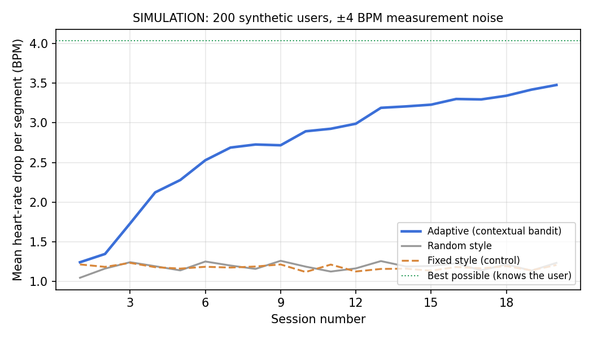

# EAMTA: music that learns what calms *you*

Most "calm music" apps guess your mood and play a playlist. EAMTA closes the loop:

1. **Measures** your heart rate with an ordinary webcam (no wearable needed) or a Bluetooth chest strap.
2. **Plays** generated music that starts near your current pace and gradually slows down (the ISO principle from music therapy).
3. **Checks whether it worked**: did your heart rate actually drop during each 90-second segment?
4. **Learns**, per person, which music style calms *you* in *your* current state, using a contextual bandit.

Spotify learns what you click. EAMTA learns from what your body does.

> Wellness prototype, not a medical device. Webcam heart rate is noisy; see [Limitations](#limitations).

## How it works

```
Browser (React)                                     Backend (Flask, Python)
──────────────────────────────────────────          ─────────────────────────────────────────
webcam ─► skin colour of forehead + cheeks ──[t,r,g,b] each frame──► rPPG (CHROM) ─► heart rate + signal quality
       └► 1 small frame / 3 s ──────────────────────────────────────► facial expression (FER) ─► face box, mood
mic / keyboard ─► check-in sentence ────────────────────────────────► DistilRoBERTa emotion model
Bluetooth strap (optional) ─► HR + beat-to-beat intervals ──────────► HRV (RMSSD)
                                                                      │
two sliders: "how pleasant / how calm?" ───────────────────────────► per-user sensor trust (fusion)
                                                                      │
Tone.js music engine ◄── preset, tempo, scale, loudness ◄──────────── session state machine
                                                                      │  each 90 s segment:
                                                                      │  reward = heart-rate drop (+HRV, +thumbs)
                                                                      ▼
                                                                contextual UCB bandit ─► next style
                                                                SQLite: every reading, segment, self-report
```

| Part | What it does | Code |
|---|---|---|
| Webcam heart rate | CHROM rPPG: resample to 30 Hz, band-pass 0.7–3 Hz, FFT peak. Each estimate gets a **quality score**; low-quality estimates never train the model. | `backend/inputs/rppg.py` |
| Bluetooth strap | Standard heart-rate profile via Web Bluetooth; RR intervals → HRV | `frontend/src/hooks/useHeartRateBLE.js`, `backend/inputs/heart_ble.py` |
| Session flow | check-in → 60 s silent baseline (resting HR) → music segments → self-report | `backend/session/manager.py` |
| Music | 5 synthesized styles. Tempo starts at your heart rate and eases toward ~60 BPM. | `backend/music/therapy_engine.py`, `frontend/src/audio/musicEngine.js` |
| Reward | Heart-rate change between the first and last 30 s of a segment (plus HRV and optional 👍/👎) | `backend/learning/reward.py` |
| Personalisation | Tabular contextual UCB1. Context = heart rate above / near / below *your* resting rate; sparse contexts borrow from the style's overall score. | `backend/learning/bandit.py` |
| Sensor fusion | Each sensor's trust = 1 / its running error against *your own* slider answers. Heart rate is used for arousal only, never for valence. | `backend/fusion/fusion_engine.py` |

### A fair self-experiment is built in
Every session runs in one of three modes:
- **adaptive**: bandit-chosen style, ISO tempo curve
- **fixed**: one style, constant tempo (control)
- **silence**: no music (control)

`scripts/evaluate.py` compares them on your real data.

## Results

### Simulation: does the learning algorithm work under realistic noise?
200 synthetic users with hidden preferences, ±4 BPM measurement noise, and 20% of segments lost to bad signal. **These are synthetic users, not real people.**



The adaptive policy reaches ~86% of the best possible heart-rate drop by session 20. Random and fixed choices stay flat. The same simulation was used to tune the exploration constant (0.1 beat 0.2–0.5).

### Real sessions
Run sessions in all three modes, then:
```bash
venv/bin/python scripts/evaluate.py --user <your-name>
```
This prints per-mode heart-rate change and writes `docs/results/real_<name>_sessions.png`. Only claim what this shows, and note how many sessions it's based on.

## Running it

Requirements: Python 3.11, Node 18+, Chrome or Edge (needed for Web Bluetooth and speech input; Safari works without those two).

```bash
# backend
python3.11 -m venv venv
venv/bin/python -m pip install -r requirements.txt
venv/bin/python backend/app.py                    # http://127.0.0.1:5001/api/health

# frontend (second terminal)
cd frontend && npm install && npm start           # http://localhost:3000
```

The first check-in downloads the DistilRoBERTa model (~330 MB) once. Data is stored in `data/eamta.db` (gitignored).

**Getting a good webcam reading:** face a window or lamp, keep your head still, avoid backlight. The guide boxes turn green once your face is found.

**Checking accuracy yourself:** count your wrist pulse for 30 s and double it, then compare with the app. Do it at rest and after 20 squats.

### Tests
```bash
venv/bin/python -m pytest backend/tests      # signal processing, reward, bandit, fusion, full API session
venv/bin/python scripts/simulate.py          # regenerates the simulation chart
cd frontend && npm test
```
The rPPG tests check that a known synthetic pulse (58–120 BPM, with uneven frame timing, sensor noise and lighting drift) is recovered within 3 BPM, and that pure noise is flagged as unreliable.

## Privacy
- Video never leaves the browser except one 320 px frame every 3 s for expression analysis. It is processed in memory and never stored.
- Heart-rate estimation only receives average colour values.
- All session data stays in a local SQLite file.

## Limitations
- **Webcam heart rate is sensitive** to motion, lighting and skin tone. It is gated by signal quality, but a chest strap is far more accurate, and HRV is only available with a strap.
- **Small effects, noisy measurements.** Music's effect on heart rate over 90 s is a few BPM, comparable to webcam noise. The bandit only learns from quality-checked segments, and conclusions need many sessions.
- **Valence (pleasant vs. unpleasant) is the weak dimension.** It comes from facial expression, the check-in text and the sliders; heart rate can't distinguish excitement from anxiety.
- **The fixed emotion → valence/arousal maps** for face and text are approximations from the circumplex model, which is why per-user trust weighting exists.
- **Real results so far** are from the author only. A proper study needs more people and randomised mode order.

## Roadmap
- Wear OS companion app (Samsung Health Sensor SDK) for continuous watch heart rate; Health Connect for sleep and resting-HR context
- Motion sensing to separate exercise from stress
- Curated real-music library tagged with valence/arousal (Essentia) alongside synthesized music
- Small multi-user study: adaptive vs. fixed vs. silence, randomised order
